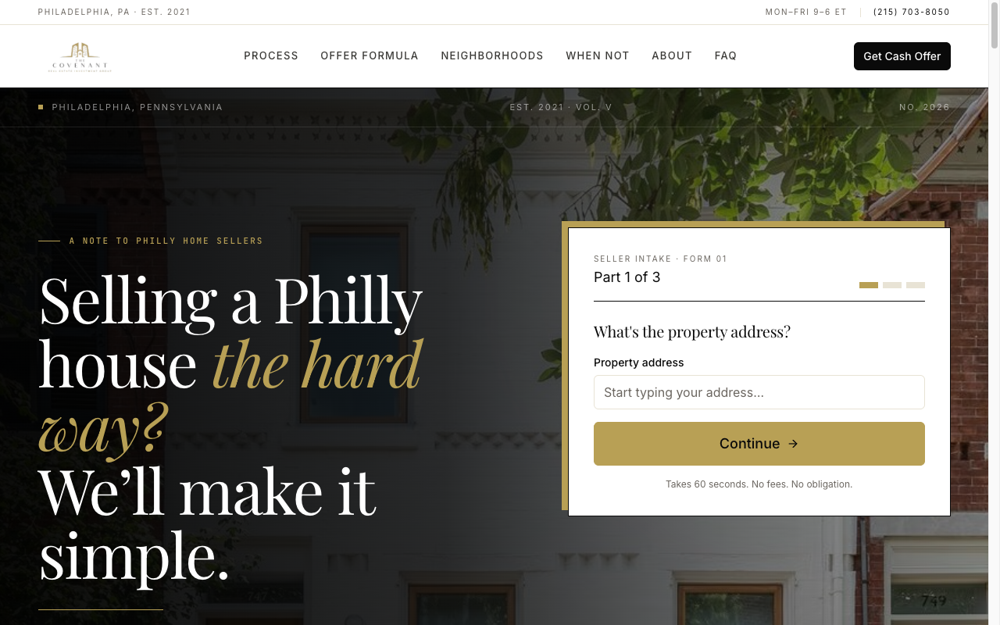

# Covenant Homes Philly: cash home buyer website

The lead-generation site for Covenant Homes Philly, a small Philadelphia home-buying business. Live at **[covenanthomesphilly.com](https://covenanthomesphilly.com)**.

Built by Watson Saintsulne with Claude Code. This repository is a clean public copy of the production code, published as a portfolio piece. Internal notes, research and strategy documents are left out on purpose.



## What it shows

- **Situation pages generated from data.** Probate, foreclosure, tax liens, inherited houses, tired landlords and more each get a full page from one typed content file (`src/content/situations.ts`), with their own social preview images.
- **Plain-spoken trust content.** FAQ, "when not to sell to us", testimonials and an About page that names the real title partner, written for nervous sellers rather than search engines.
- **Lead capture that holds up.** The offer form validates with `react-hook-form` and `zod`, then delivers through `resend` with server-side checks.
- **AI and search readiness.** `public/llms.txt` and `public/ai.txt` describe the business for AI assistants; pages carry structured data for local search.
- **Performance budget.** A Lighthouse check runs on every push to main (`.github/workflows/lighthouse.yml`).

## Stack

Next.js (App Router, TypeScript), React, Tailwind CSS, react-hook-form, zod, Resend, Vercel Analytics, deployed on Vercel.

## Run it locally

```bash
npm install
cp .env.example .env.local   # the form needs a Resend key to send; every page renders without one
npm run dev
```

Then open http://localhost:3000.

---

Questions about how it was built: [support@edenvillelabs.com](mailto:support@edenvillelabs.com).
